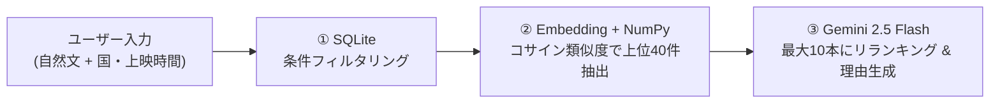

# 映画検索アプリ（SQLite × ベクトル検索 × LLM リランキング）

約2,500本の映画データから、製作国や上映時間といった条件と「今の気分・観たい雰囲気（自然文）」を組み合わせて映画を探せるWebアプリケーションです。  
リレーショナルデータベース（SQLite）、ベクトル意味検索（Embedding + NumPy）、生成AI（Gemini 2.5 Flash）を組み合わせ、高速かつ高精度なレコメンドを実現しています。

---

## 主な機能

- **製作国・上映時間による条件絞り込み**
  - SQLiteの `WHERE` / `BETWEEN` クエリにより、製作国や上映時間（分単位のレンジ指定）で映画を高速にフィルタリングできます。
- **自然文による意味検索（セマンティックサーチ）**
  - 「泣けるSF映画」「週末に気軽に観られるコメディ」のような自然な文章を入力すると、タイトルやあらすじに同じ単語が含まれていなくても、文脈・意味が近い映画を検索し、AIによる1行のおすすめ理由とともに最大10本提案します。
- **条件一覧表示＆ソート**
  - 検索バーが空欄のときはLLMを呼び出さず、SQLiteのみで公開年順・上映時間順の一覧を即座に表示します。

---

## 技術スタック

| カテゴリ | 使用技術 |
| :--- | :--- |
| 言語 | Python 3 |
| フロントエンド / UI | Streamlit |
| データベース | SQLite3（標準ライブラリ `sqlite3`） |
| ベクトル演算 | NumPy（コサイン類似度計算・`.npz` 圧縮保存） |
| AI / LLM | Google Gemini API（`google-genai` SDK: `gemini-embedding-001`, `gemini-2.5-flash`） |
| 環境変数管理 | `python-dotenv` |

---

## 工夫したアーキテクチャ（ハイブリッド2段階検索）

全件の映画データを毎回LLM（Gemini）に渡すと、トークン消費量・APIコスト・応答時間（レイテンシ）が膨大になります。本アプリでは以下の**3ステップのパイプライン**により、低コスト・高速レスポンス・高精細なレコメンドを両立しています。



1. **SQLiteによる確実な条件絞り込み（ハードフィルタ）**
   - LLMが苦手とする数値条件（上映時間 `runtime BETWEEN ? AND ?`）や属性一致（`country = ?`）を、まずSQLite側で正確に絞り込みます。
2. **Embedding ＋ NumPy による高速ベクトル検索（第1段階：Recall重視）**
   - 映画の「タイトル・ジャンル・あらすじ」を事前に `gemini-embedding-001` でベクトル化・L2正規化して `embeddings.npz` に保存しています。
   - 検索時はユーザーの入力文のみをベクトル化し、条件に合致した映画ベクトルとの内積（コサイン類似度）を `numpy` の行列演算（`filtered_vecs @ query_vec`）でミリ秒単位に計算し、意味が近い上位40件に絞り込みます。
3. **Gemini 2.5 Flash によるリランキングと理由生成（第2段階：Precision重視）**
   - ベクトル検索で抽出した上位40件の候補だけを `gemini-2.5-flash` に渡し、ユーザーのニュアンスに最も合う最大10本の選定（リランキング）と「1行のおすすめ理由」をJSON形式で構造化出力させます。

---

## ファイル構成

```text
movie_simple/
├── app.py                # Streamlit Webアプリ本体（検索UI・ベクトル検索・リランキング）
├── build_db.py           # 元データから必要なカラムを抽出・整形して movies.db を構築するスクリプト
├── build_embeddings.py   # 映画テキストをバッチ処理でベクトル化し embeddings.npz を生成するスクリプト
├── movies.db             # 映画メタデータ格納用 SQLite データベース
├── embeddings.npz        # 事前生成された映画ID配列・正規化済みベクトル配列
├── requirements.txt      # 依存パッケージ一覧
├── .env.example          # 環境変数設定ファイルのサンプル
└── .gitignore            # Git管理除外設定
```

---

## ローカルでのセットアップ・起動手順

### 1. リポジトリのクローンと仮想環境の作成

```bash
git clone <このリポジトリのURL>
cd movie_simple

python3 -m venv .venv
source .venv/bin/activate
pip install -r requirements.txt
```

### 2. 環境変数（Gemini APIキー）の設定

`.env.example` をコピーして `.env` を作成し、ご自身の Gemini API キーを設定してください。

```bash
cp .env.example .env
```

`.env` の中身：
```env
GEMINI_API_KEY=あなたのGemini_APIキー
```

### 3. アプリの起動

リポジトリには構築済みの `movies.db` と `embeddings.npz` が含まれているため、以下のコマンドですぐに起動できます。

```bash
streamlit run app.py
```

（※データベースやベクトルデータを一から再生成する場合は、`python build_db.py` および `python build_embeddings.py` を順に実行してください。）
